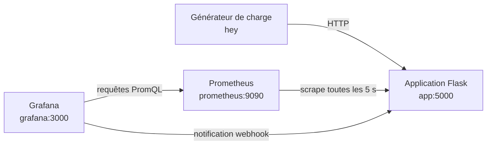
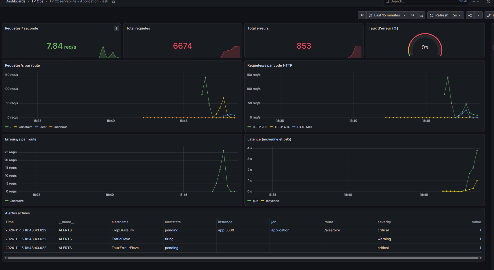
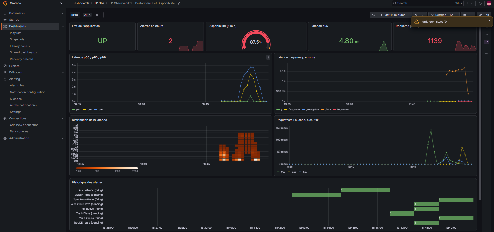

# TP Observabilité — Flask, Prometheus & Grafana

<p>
  
  
</p>

Mise en place d'une chaîne d'observabilité complète autour d'une application Flask :
instrumentation des métriques, collecte par Prometheus, tableaux de bord Grafana, alertes et
notifications webhook. L'application expose volontairement des points d'entrée dégradables
(erreurs, latence, exceptions) pour valider la supervision sous charge.


## Architecture



| Service | Image | Port hôte | Rôle |
|---|---|---|---|
| `app` | construite (`python:3.12-slim`) | 5000 | Application supervisée, expose `/metrics` et reçoit les webhooks |
| `prometheus` | `prom/prometheus:latest` | 9090 | Collecte, stockage et évaluation des règles d'alerte |
| `grafana` | `grafana/grafana:latest` | 3000 | Tableaux de bord, alerting et point de contact webhook |

## Aperçu





## Prérequis

- Docker Desktop avec Docker Compose
- PowerShell (Windows) pour le script de charge
- Navigateur web

## Démarrage rapide

```powershell
# Construire l'image et démarrer la pile
docker compose up --build -d

# Vérifier l'état des services
docker compose ps

# Suivre les journaux de l'application
docker compose logs -f app
```

| URL | Service |
|---|---|
| http://localhost:5000/ | Application Flask |
| http://localhost:5000/metrics | Métriques Prometheus |
| http://localhost:9090/targets | Cibles Prometheus |
| http://localhost:9090/alerts | Alertes Prometheus |
| http://localhost:3000/ | Grafana (`admin` / `admin`) |

Pour arrêter la pile :

```powershell
docker compose down
```

## Points d'entrée de l'application

| Route | Comportement |
|---|---|
| `/` | Réponse 200 « Bonjour, application supervisee ! » |
| `/erreur` | Erreur contrôlée (500) |
| `/aleatoire?taux=40` | Échec aléatoire selon un pourcentage (30 % par défaut) |
| `/lent?max=3` | Latence aléatoire entre 0 et `max` secondes |
| `/exception` | Exception non gérée (`ZeroDivisionError`) |
| `/nimportequoi` | 404 (compté dans les requêtes, pas dans les erreurs) |
| `/metrics` | Exposition des métriques au format Prometheus |
| `/webhook-alerte` | Réception des notifications Grafana (POST JSON) |

## Métriques exposées

| Métrique | Type | Étiquettes | Signification |
|---|---|---|---|
| `app_requetes_total` | Counter | `route`, `code` | Nombre cumulé de requêtes traitées |
| `app_erreurs_total` | Counter | `route` | Nombre d'erreurs serveur (code ≥ 500) |
| `app_latence_secondes` | Histogram | `route` | Distribution des durées de traitement |

Les routes `/metrics` et `/webhook-alerte` sont exclues du comptage.

## Tableaux de bord

Les dashboards sont provisionnés automatiquement au démarrage de Grafana.

| Fichier | Contenu |
|---|---|
| `grafana/dashboards/observabilite.json` | Débit, erreurs, taux d'erreur, latence, alertes actives |
| `grafana/dashboards/performance.json` | Disponibilité, p50/p95/p99, heatmap, répartition 2xx/4xx/5xx |

Filtre disponible : variable `route` sur le dashboard Performance.

## Alertes

### Règles Prometheus (`alertes.yml`)

| Alerte | Condition | Durée | Sévérité |
|---|---|---|---|
| `TropDErreurs` | `increase(app_erreurs_total[1m]) > 5` | 30 s | critical |
| `TraficEleve` | `sum(rate(app_requetes_total[30s])) > 10` | 30 s | warning |
| `TauxErreurEleve` | `sum(increase(app_erreurs_total[1m])) > 5` | 1 min | critical |
| `AucunTrafic` | `sum(rate(app_requetes_total[2m])) == 0` | 2 min | info |
| `ApplicationInjoignable` | `up{job="application"} == 0` | 15 s | critical |

### Règles Grafana (`grafana/provisioning/alerting/rules.yml`)

| Alerte | Condition | Durée | Sévérité |
|---|---|---|---|
| `Grafana - Trafic eleve` | Débit > 10 req/s | 30 s | warning |
| `Grafana - Taux d'erreur eleve` | Taux d'erreur > 5 % | 1 min | critical |
| `Grafana - Latence p95 elevee` | p95 > 1 s | 30 s | warning |
| `Grafana - Application injoignable` | `min(up{job="application"}) < 1` | 20 s | critical |

Le point de contact `webhook-app` envoie les notifications vers
`http://app:5000/webhook-alerte` ; l'application les journalise.

## Tests de charge

Le script `test.ps1` enchaîne cinq phases avec [hey](https://github.com/rakyll/hey) :

| Phase | Cible | Charge | Objectif |
|---|---|---|---|
| 1 | `/` | 30 s, 20 connexions | Trafic normal |
| 2 | `/aleatoire?taux=40` | 45 s, 20 connexions | Taux d'erreur élevé |
| 3 | `/lent?max=3` | 45 s, 20 connexions | Pic de latence |
| 4 | `/exception` | 300 requêtes, 20 connexions | Exceptions non gérées |
| 5 | `/nimportequoi` | 20 s, 10 connexions | 404 hors compteur d'erreurs |

```powershell
.\test.ps1
```

## Captures

| Écran | Fichier |
|---|---|
| Conteneurs Docker | [capture-01](rapport/captures/capture-01-docker-ps.png) |
| Métriques | [capture-02](rapport/captures/capture-02-metrics.png) |
| Cible Prometheus | [capture-03](rapport/captures/capture-03-targets.png) |
| Dashboard Observabilité | [capture-04](rapport/captures/capture-04-dashboard-observabilite.png) |
| Dashboard Performance | [capture-05](rapport/captures/capture-05-dashboard-performance.png) |
| Alerting Grafana | [capture-06](rapport/captures/capture-06-grafana-alerting.png) |
| Alertes Prometheus | [capture-07](rapport/captures/capture-07-prometheus-alerts.png) |
| Notification webhook | [capture-08](rapport/captures/capture-08-webhook-logs.png) |
| Exceptions | [capture-09](rapport/captures/capture-09-exception-logs.png) |

## Structure du projet

```text
.
├── app.py                     # Application Flask instrumentée
├── Dockerfile                 # Image python:3.12-slim
├── docker-compose.yml         # app + prometheus + grafana
├── requirements.txt           # flask, prometheus-client
├── prometheus.yml             # scrape 5 s + rule_files
├── alertes.yml                # Règles d'alerte Prometheus
├── test.ps1                   # 5 phases de charge (hey)
├── grafana/
│   ├── dashboards/
│   │   ├── observabilite.json
│   │   └── performance.json
│   └── provisioning/
│       ├── alerting/
│       │   ├── contact-points.yml
│       │   └── rules.yml
│       ├── dashboards/dashboards.yml
│       └── datasources/prometheus.yml
└── rapport/
    ├── Compte_Rendu_TP_Observabilite.pdf
    ├── compte-rendu.html
    ├── captures/
    └── img/
```

## Rapport

Le compte rendu complet du TP est disponible ici :
[**Compte_Rendu_TP_Observabilite.pdf**](rapport/Compte_Rendu_TP_Observabilite.pdf)

## Auteur et encadrant

- **Étudiant :** Mohammed Bourass
- **Professeur :** Youssef Aounzou

Travaux pratiques d'observabilité — usage pédagogique.
